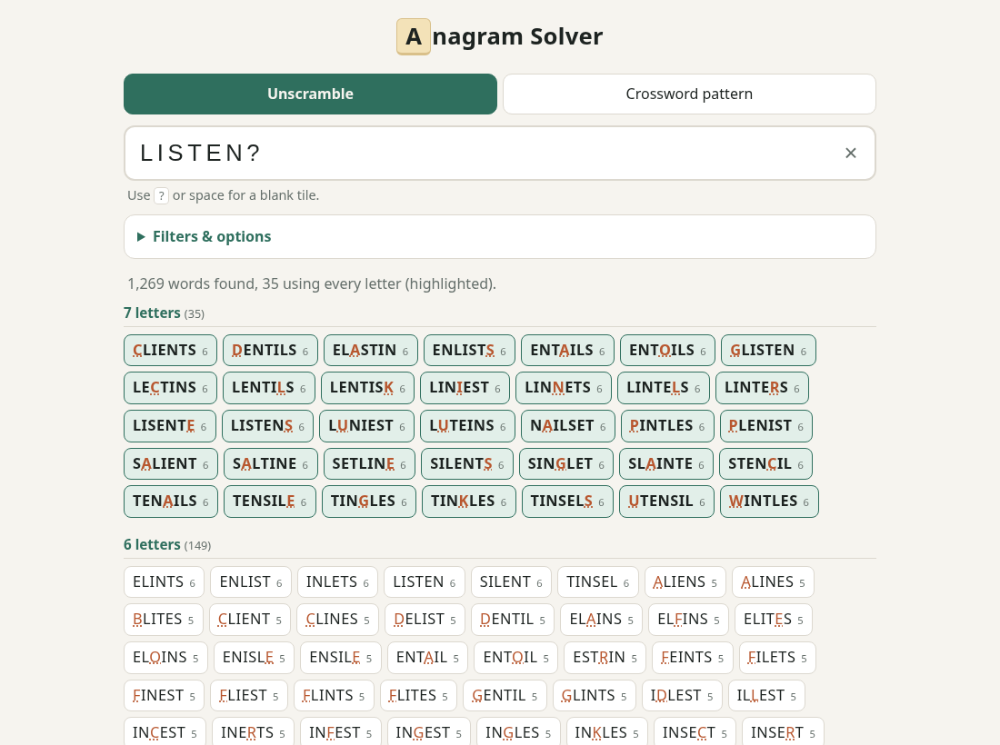
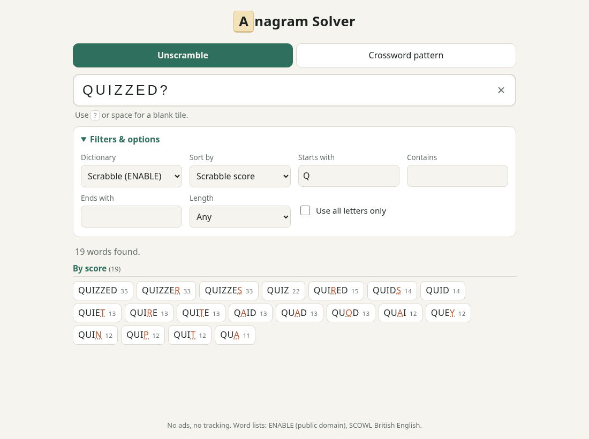
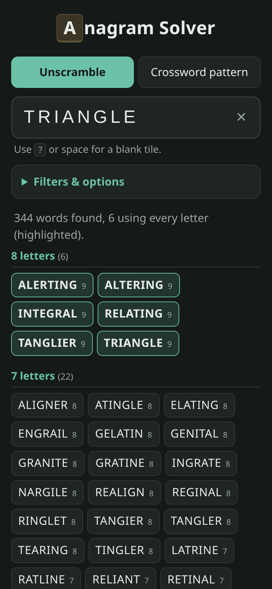
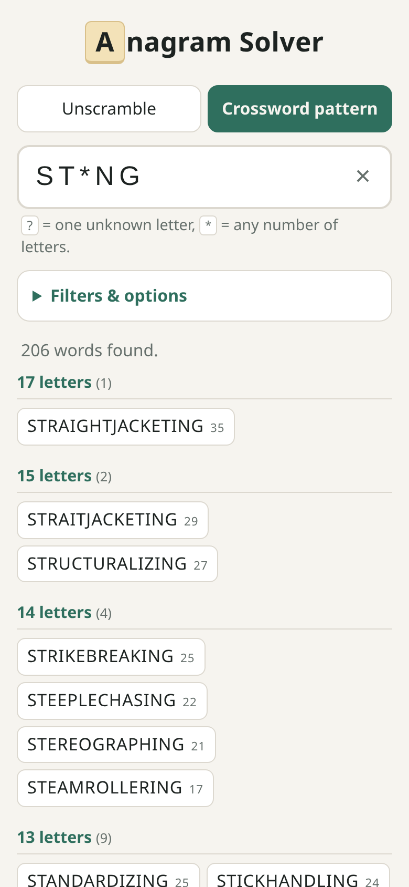

# Anagram Solver

Ad-free anagram solver / word unscrambler. Plain static HTML/CSS/JS, no build step,
all searching happens in the browser so it works offline (and can be wrapped as an Android app).

- **Unscramble**: every word buildable from your letters, `?` or space = blank tile
  (blank letters shown underlined, scored 0). Words using every letter are highlighted.
- **Crossword pattern**: `?` = one letter, `*` = any run of letters.
- Filters: starts with / contains / ends with, length, use-all-letters; sort by length, score or A–Z.
- Tap a word to open its Wiktionary definition.

## Screenshots

  
  

Word lists (`words/`, regenerate with `tools/build-words.sh`):
- `scrabble.txt`: ENABLE (public domain), 173k words.
- `british.txt`: SCOWL British English from Arch's `words` package, lowercase a–z only.

## Run locally

    docker compose up -d     # http://localhost:8090

## Deploying

It's a static site: serve the files from any web server or static host. `nginx.conf` is the
config used by `compose.yaml`; it sends `Cache-Control: no-cache, no-transform` so browsers pick
up updates and CDNs don't rewrite the page or its scripts.
