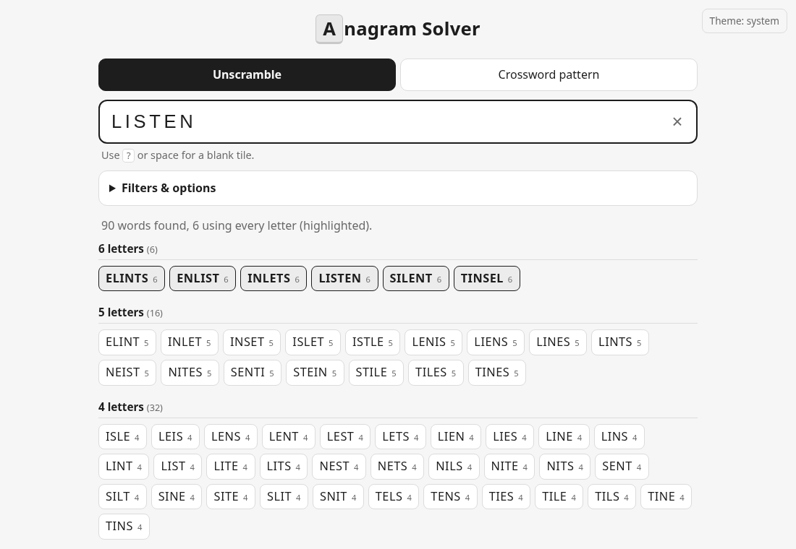
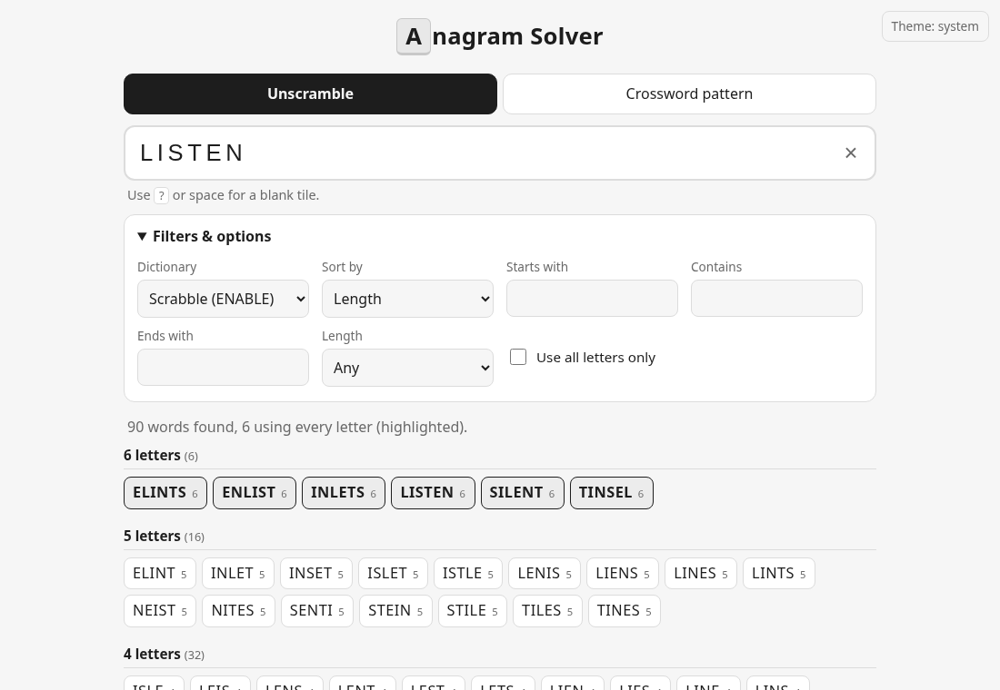
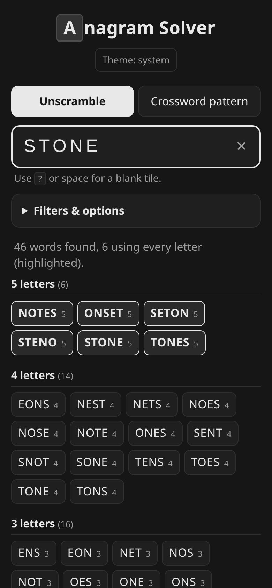

#  Anagram Solver

**An ad-free word unscrambler and crossword helper.**

Type your letters and see every word you can make. No ads, no tracking, and it works offline once loaded, because all the searching happens in your browser.

## Features

- **Unscramble letters**: every word you can build, with `?` or a space as a blank tile
- **Crossword patterns**: `?` for one letter, `*` for any run of letters
- **Filters**: starts with, contains, ends with, length, and use all letters
- **Sort** by length, Scrabble score or A–Z
- **Definitions**: tap a word to look it up on Wiktionary
- **Two word lists**: Scrabble (ENABLE) or British English
- **Android app**: works offline with no internet permission, follows your phone's colours, and keeps the controls in thumb reach
- **Works in any browser**, in light or dark, and can be installed as a web app

  
  
  

## Get it

- **Android**: download the APK from [Releases](https://github.com/Imdabossou/AnagramSolver/releases/latest). Needs Android 8 or newer. Select a word in any app and choose **Unscramble** to open it here.
- **Web**: it's a static website, so host the files on any web server, or run it on your own computer with `docker compose up -d` (then open http://localhost:8090).

## Licence

Free and open source under the [GNU AGPL v3 or later](LICENSE). Want to work on it? See [BUILDING.md](BUILDING.md).
