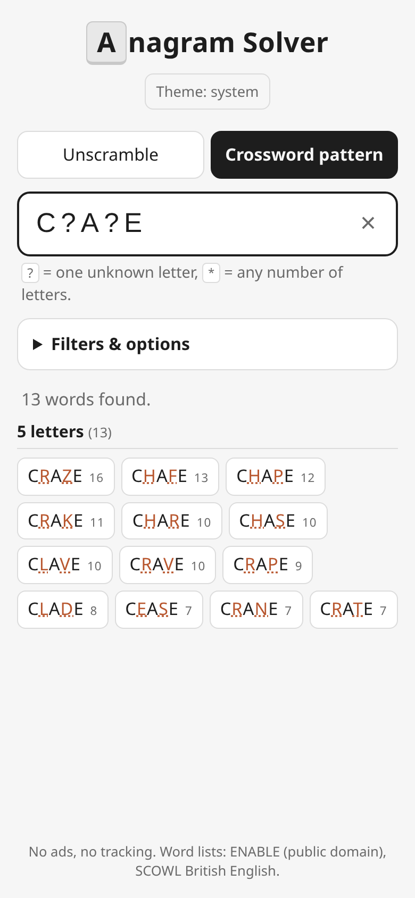

#  Anagram Solver

**An ad-free word unscrambler and crossword helper.**

Type your letters and see every word you can make. No ads, no tracking, and it works offline once loaded, because all the searching happens in your browser.


## Features

- **Unscramble letters**: every word you can build, with `?` or a space as a blank tile
- **Crossword patterns**: `?` for one letter, `*` for any run of letters
- **Filters**: starts with, contains, ends with, length, and use all letters
- **Sort** by length, Scrabble score or A–Z
- **Definitions**: tap a word to look it up on Wiktionary
- **Two word lists**: Scrabble (ENABLE) or British English
- **Works on phones**, in light or dark, and can be installed as an app

<p>
  
  
  
</p>

## Get it

It's a static website, so host the files on any web server. To run it on your own computer with Docker:

```sh
docker compose up -d     # then open http://localhost:8090
```

An Android app is planned.

## Licence

Free and open source under the [GNU AGPL v3 or later](LICENSE). Want to work on it? See [BUILDING.md](BUILDING.md).
